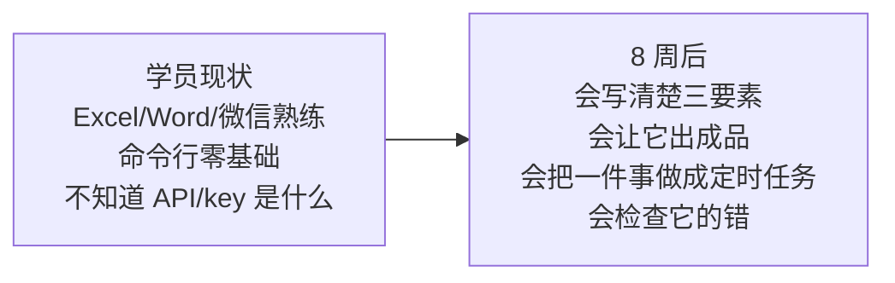
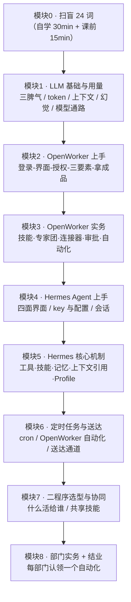
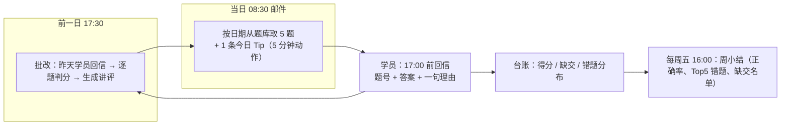
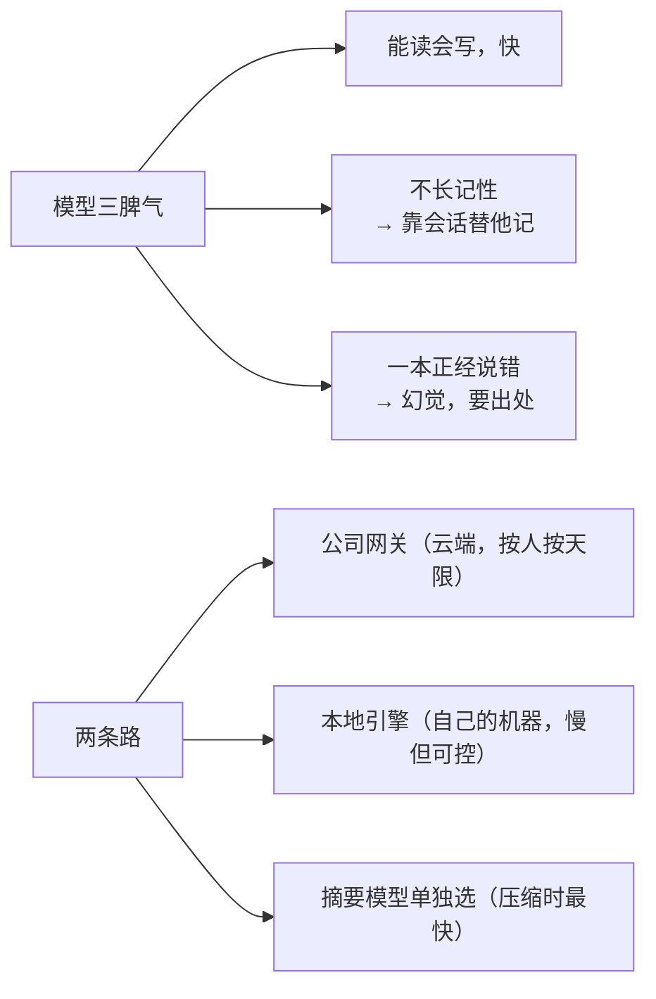
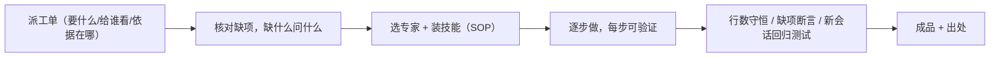
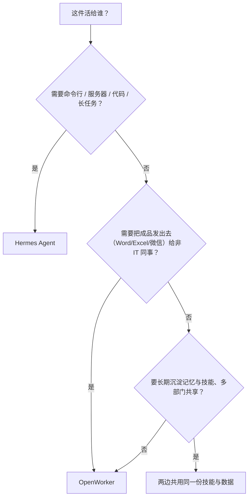

# SMJ AI 应用培训教学大纲

**对象**：斯米伽（SMJ）内部人员，IT 基础薄弱（会用 Word/Excel/微信，不懂命令行、不懂 API）。
**载体**：两个程序 —— ① **OpenWorker 中文版**（`D:\smj-apps\openworker`，桌面应用，面向全员）② **Hermes Agent**（命令行 + 桌面应用，面向 IT、开发、数据分析、部门骨干）。
**取向**：实务为主。每模块 **15 分钟概念 + 45 分钟动手 + 15 分钟验收**；概念一律配车间类比和图，不要求背诵。
**周期**：8 周，每周一次 2 小时集中课；**每个工作日 08:30 邮件发 5 道题**（机制见第 5 章），17:00 前反馈，次日附答案讲评。

> 本章是"纲"，[00-预备课](./00-预备课-基础概念.md) 与 [01/02/03 三次课](./README.md) 是已有的"课件"；本大纲把二者串成一条线，并补齐 Hermes Agent 与考核两部分。

---

## 1. 学员画像与前置条件



开课前每人必须到位（讲师课前 3 天核对）：

| 前置 | 要求 | 卡在这里就停止 |
| --- | --- | --- |
| OpenWorker 已安装并登录 | 按 [用户手册](../手册/03-用户手册.md) 第 1–3 步；**登录验证码手动输 6 位数字，不要点邮件里的链接** | 收不到验证码 → 查 Access 名单（见 [管理员初始化手册](../手册/01-管理员初始化手册.md) §3.4） |
| 每人一把 key | 以人名命名（如 `张三-技术研发部`），一对一交付，不进群、不进共享表 | key 转发给别人 = 事故，先讲这条 |
| 样例数据 | `D:\OpenWorker培训\` 七个文件夹，课前按上课日重新生成 | 路径不一致 → 课件里写的地址全对不上 |
| 语音输入模型 | 每台机 设置 ▸ 语音输入 下载两个包（约 455 MiB），测一次麦克风 | 课上现下会卡时间 |
| Hermes（仅骨干班） | Windows 原生或 WSL2 装好，跑通 `hermes doctor` | 跑不通的学员转基础班，不影响全员课程 |

---

## 2. 培养目标（三层，可检验）

### 2.1 认知层：知道 AI 是什么、不是什么

结业时学员能用自己的话说清这五件事（口头抽查）：

1. 模型是"读遍图书馆的顾问，第一天来公司"——聪明但不懂 SMJ，**必须喂真台账**。
2. **token** 是计量单位（跳表），公司网关按人按天限（rpm/rpd/tpd），用量在 **设置 ▸ 模型** 能看。
3. **上下文** 是办公桌，纸摊多了会找不着 → 一事一会话。
4. **幻觉**：不知道也敢答，编得还挺像 → 防法只有两条：喂真台账、要求附出处。
5. **agent** 和聊天机器人的区别：一个只出嘴，一个出手（读文件、写文件、发消息），且**动手前先问你**。

### 2.2 操作层：两个程序各自会用

| 能力 | 在 OpenWorker | 在 Hermes Agent |
| --- | --- | --- |
| 交代任务（三要素：读什么 / 要什么 / 存成什么） | ✅ 全员必须会 | ✅ |
| 拿成品（Word / Excel / 网页） | ✅ 全员必须会 | ✅ |
| 装技能（SOP）、选专家 | ✅ 点即用 | ✅ 自己写 SOP 并让程序维护 |
| 逐个授权外部工具（连接器 / MCP） | ✅ | ✅ |
| 动手前审批、不在时攒进收件箱 | ✅ | ✅（危险命令需确认） |
| 定时干活（到点自动跑） | ✅ 模板 + 定时 | ✅ cron 任务 |
| 记忆与技能沉淀（越用越熟） | ✅ | ✅ |

### 2.3 习惯层：三条硬习惯（考核计入平时分）

1. **一事一会话**：不把十件事塞进一个会话。
2. **要出处**：任何结论要它指出"来自哪个文件、哪一行"；没出处的数字不进周报。
3. **验收前不签字**：写文件、发消息、执行命令，看清它要干什么再点允许。

---

## 3. 课程地图



| 模块 | 时长 | 主线实操（SMJ 场景） | 必配图 | 学员产出 |
| --- | --- | --- | --- | --- |
| 0 | 0.5 h | 无（自学） | 概念类比表 | 24 词速查卡 |
| 1 | 2 h | 看用量页；三要素改写；"让它附出处" | 模型三脾气图；token 跳表图；本地/云端通路图 | 一张"我部门的三要素模板" |
| 2 | 2 h | 实务一 质量周报（机加/热处理/装配三车间合表） | 界面导览截图（编号标注）；三要素三段式图 | 一份可发出去的 Word 周报 |
| 3 | 2 h | 实务二 交期风险；实务三 每日点检提醒；实务四 备件预警 | 审批/收件箱流程；自动化"派工单+闹钟"图；专家团分工图 | 一个跑通的自动化 + 一条微信送达 |
| 4 | 2 h | 骨干班：跑通一次 `hermes chat -q`；桌面应用登录与设置 | Hermes 四面界面图；config.yaml / .env 分工图（设置归设置、钥匙归钥匙） | 一份"我机器上哪个文件管什么"对照表 |
| 5 | 2 h | 给 Hermes 写一份本部门 SOP 技能；跨会话记忆验证 | 技能渐进披露图；记忆三文件图（SOUL/USER/MEMORY） | 一个 `.md` 技能文件 |
| 6 | 2 h | **把本大纲的每日考试机制跑起来**（就是这套机制本身） | 出题→送达→反馈→讲评 闭环图；cron 五种动作表 | 一个真在跑的定时任务 |
| 7 | 1.5 h | 三件活现场选程序并说明理由 | 二程序对照表；选型决策树 | 一页选型卡 |
| 8 | 2 h（+1 h 结业） | 各部门认领一个自动化并跑通 | 结业验收单（勾选表） | 可复用的 SOP 技能 + 自动化 |

---

## 4. 图示化与操作指引规范（讲师必须照做）

这一章不是建议，是课件验收标准。每份课件、每个实操都必须满足：

### 4.1 每个实操固定三段式

```text
① 做什么（点哪里、输什么，含完整路径）
② 屏幕上应该看到什么（原话或截图）
③ 如果没看到 → 怎么办（最多 3 条排查）
```

例（模块 2 · 授权文件夹）：

```text
① 左侧「工作文件夹」→ 粘贴 D:\OpenWorker培训\01-质量周报 → 确认
② 应看到：文件夹名出现在会话顶部的授权清单里
③ 没看到：a) 路径是不是打错了（检查反斜杠） b) D 盘上有没有这个文件夹 c) 权限弹窗有没有被安全软件拦
```

### 4.2 每份课件必配"三图一表"

1. **一张流程图**（mermaid，从左到右，不超过 8 个节点）。
2. **一张界面截图带编号红框**，编号与步骤文字一一对应，命名 `img/M2-1-工作文件夹.png`。
3. **一张类比表**：概念 → 车间里对应什么（沿用预备课的类比体系：文件=一张纸，路径=门牌地址，技能=SOP，连接器=插座，审批=签字）。
4. **一张"现象 → 原因 → 处理"排错表**，至少 4 行。
5. **Tip 配图**：凡考进题库的 Tip，配一张带编号红框的界面截图，命名 `img/T-B01-开工前核对.png`（或 `assets/tip-<编号>.png`），编号与「怎么做」那一行对应；脱敏后使用（真人姓名、key、公司邮箱域、客户名一律不出现）。

### 4.3 术语与命令规则

- 术语首次出现必须给类比 + 英文原名，并在末尾速查表登记。
- 命令行每次不超过 2 行，且每行给"这行干什么"的一句话注释。
- 严禁纯文字连续 10 行不分段；严禁"它会自动处理"这类不可验证的说法。
- 所有截图必须脱敏：不出现真人姓名、不出现 key、不出现公司邮箱域。

---

## 5. 每日考试机制（工作日 08:30 邮件 + 反馈闭环）



### 5.1 出题规则

| 项 | 规则 |
| --- | --- |
| 发送时间 | 工作日 **08:30**（cron：`30 8 * * 1-5`，Asia/Shanghai） |
| 题量 | 5 题 = 当周模块 **2 单选 + 1 判断 + 1 简答** + 1 道回顾题（上一周模块，题型不限）；满分 100（每题 20 分） |
| 题目来源 | 4 题取**当周模块**题库；1 题取**上一周模块**（回顾题），错题重练优先 |
| 难度 | 概念题 ≤ 40%，操作题 ≥ 60%（"点哪里/输什么"类） |
| 题库 | `题库/questions.json`（现 **100 题**，每模块 12–14 题：约 5–7 单选 / 3–4 判断 / 3–4 简答）；出题必须**可复现**：同一日期重跑结果相同 |
| 今日 Tip | 每封邮件附 **1 条 Tip**（`tips/tips.json`，现 **68 条 / 7 类**）：按当周模块轮换，每 3 个出题日插一条「防错与安全」或「排障」横切类；选取只依赖日期，同一天重跑是同一条 |
| 禁止 | 出题不能依赖记忆或"讲师感觉"；不能出无法验证的主观题 |

### 5.2 反馈与评分

- 学员**回信**（回复到发件邮箱），格式：`题号 答案 一句理由`。17:00 前收到计入当日常规分；17:00 后算补交（当周补交 ≤ 2 次）。
- 单选题判分确定；判断题判"对/错 + 理由是否说到点上"；简答按**要点给分**（题库里写明要点），答到 3 个要点里 2 个得 14 分。
- 次日邮件附**昨日答案与讲评**（讲评只写"为什么错"，不超过 3 行）。
- 错题闭环：同一学员同一模块连续 2 次错 → 讲师单独 10 分钟辅导，并在周小结点名。

### 5.3 每周小结（周五 16:00）

固定四行：① 平均正确率与环比 ② 本周 Top5 错题（题号 + 错的人数）③ 缺交名单 ④ 下周一预告（模块 + 实操内容）。

### 5.4 数据台账

```csv
date,learner,email,mod,q1,q2,q3,q4,q5,score,submitted_at,note
2026-11-02,张三,alice@example.com,M1,2,3,1,对,要点2/3,80,10:12,简答漏"出处"
```

台账由脚本自动写入，讲师只在"note"列写批语。

### 5.5 每日 Tip（每封邮件附 1 条：先做 5 分钟动作，再答题）

**七类**（数据源 `题库/../tips/tips.json`，现 68 条；讲义由脚本生成 [12-每日Tip清单](./12-每日Tip清单.md)）：

| 类 | 条数 | 这类解决什么 |
| --- | --- | --- |
| A 省钱与 token | 13 | 同样的活少花钱 |
| B 提准度、少返工 | 15 | 一次做对 |
| C 防错与安全 | 9 | 不出事、不泄密 |
| D 定时与送达 | 7 | 让它按时自己跑，还送到位 |
| E 界面与输入效率 | 10 | 手熟 |
| F 排障 | 6 | 卡住了怎么办 |
| G Hermes 专属 | 8 | 命令行侧的操作 |

**每条固定五段式**（与实操课件同一骨架，照此写才允许进邮件）：
`在哪 → 怎么做 → 为什么 → 怎么算做对了 → 常见误设`。

- 邮件里写成「今天先做这一件事（5 分钟，做完再答题）」；做不到就在回信里写**卡在第几步**——Tip 不计分，但周五小结统计卡住率，同一类卡住 ≥3 人下周课上讲。
- 选取规则：按当周模块的池子推进，每 3 个出题日插一条「防错与安全 / 排障」横切类；只依赖日期，所以同一天重跑是同一条。
- 凡考进题库的 Tip 必须配**带红框的界面截图**（先脱敏），清单的「会考」列标了题号。
- 范例（学员截图那条）：`设置 ▸ 上下文优化 ▸ 开工前核对`——第一次交代活儿时先核对「要什么 / 给谁看 / 依据在哪 / 按什么口径」，缺什么用一张选择题卡问什么；要素齐就不弹卡，也就不会长篇乱展开（ask 模式下最容易读到一长串没依据的回答）。这条是 **T-B01**，已出题 **M1-13**。

### 5.6 实现方式（跑在 Hermes 的定时任务上）

**出题走脚本，判分走模型**——出题要每天稳、可复现、不花 token；讲评需要语言组织，才交给模型。

已经写好并跑过的东西在 `docs\培训\题库\`：`questions.json`（86 题）、`assemble_quiz.py`、`roster.example.csv`。机制细节与上线检查见 [11-每日考试机制](./11-每日考试机制.md)。

```text
# 讲师机自测（已实测通过）
python docs\培训\题库\assemble_quiz.py --check                    # 题库体检：每题一周内出现 1.7–2.5 次
python docs\培训\题库\assemble_quiz.py --check-tips               # Tip 库体检：68 条 / 7 类，每周池 ≥4 条
python docs\培训\题库\assemble_quiz.py --tips-md                  # 由 tips.json 重新生成《每日Tip清单》讲义
python docs\培训\题库\assemble_quiz.py --date 2026-11-02 --simulate 40   # 40 个出题日：无单日内重题
python docs\培训\题库\assemble_quiz.py --date 当天 --commit        # 正式发信后登记，避免短期重题

任务 A（纯脚本模式，不经模型）：工作日 08:30（30 8 * * 1-5）
  上面这条 --commit 命令的 stdout 原样作为邮件正文发出，抄送讲师邮箱。

任务 B（走模型）：工作日 17:30（30 17 * * 1-5）
  提示词见 templates/grading-prompt.md；读回信 → 按题库要点判分 → 写成绩台账 → 生成讲评，次日随题附上。

任务 C（走模型）：周五 16:00（0 16 * * 5）：读台账 → 四行周小结 → 邮件。
```

实测数据（本机 2026-10-26）：`--simulate 40` → 槽位 200、用到 86 道题、整期复用 57%、**单日出现重复的天数 0**；`--check` → 八个模块每题一周内平均出现 2.0–2.5 次（间隔重复，属可接受区间）。

- 邮件通道二选一：① 给助理专用邮箱（如 `ai-peixun@smjtools.com`），用 [Himalaya 技能](https://hermes-agent.nousresearch.com/docs/guides/agent-email-address) 收发（IMAP/SMTP + 应用密码，2FA 账号必须用 app password）；② 用 Hermes 的 Email 通道（别人发邮件给它、它在原信里回复）。**专用邮箱和聊天邮箱分开**。
- Hermes cron 可用自然语言排期、按任务挂技能、结果送达原聊天/本地文件/已配置平台；无模型的纯脚本模式正适合出题。详见 [Cron Jobs](https://hermes-agent.nousresearch.com/docs/user-guide/features/cron)。
- OpenWorker 侧等价物：把任务 A 做成"工作文件夹 + 定时运行 + 发送到微信/邮箱"的自动化（要求 0.6.14 及以上版本），无人值守时它会把要发邮件的动作攒进收件箱等审批——**这条要在课上讲清楚：定时任务不会自作主张发消息**。

---

## 6. 逐模块要点（讲师提纲）

### 模块 0 · 扫盲 24 词

文件/文件夹/路径/扩展名/本地与云端 → 程序/命令/API 与 key → LLM/token/提示词/上下文/幻觉 → agent/会话/技能/连接器/MCP/自动化/工作流/审批与收件箱 → 专家/专家团/专家团队长。
用现有 [00-预备课](./00-预备课-基础概念.md) 原样发，不重写。

### 模块 1 · LLM 基础与用量



现场演示三件事：① 设置 ▸ 模型 看自己的用量与限额 ② 同一个问题，写"三要素"前后对比 ③ 要求"每个数字标出处"，看它能否指出文件与行号。
概念落点：token=跳表、上下文=办公桌、压缩=收拾桌子（摘要模型慢会导致"Compacting…"很久）。

### 模块 2 · OpenWorker 上手（沿用第一次课）

界面导览五站：会话列表 / 工作文件夹 / 专家库（技能）/ 连接器 / 收件箱（待批）。
实操 = 实务一 质量周报（三车间合表 + 上周周报当格式参考）。
必讲：写文件前它会问你 → **你点头才动**。

### 模块 3 · OpenWorker 实务与自动化（沿用第二、三次课）



要点：把本部门操作规程写成技能；"拆小步 → 抽查 → 合并口径 → 行数守恒"是制造现场最有用的一招。

### 模块 4 · Hermes Agent 上手（骨干班）

四面界面：CLI（`hermes`）、TUI、桌面应用、Web dashboard。
两条硬规矩（画图讲）：**钥匙归 `.env`，设置归 `config.yaml`**；不要手改 config.yaml，用 `hermes config set`。
实操：跑通一条 `hermes chat -q "…"`（一句话任务，出文件），再看会话恢复。

### 模块 5 · Hermes 核心机制

- **技能**：给程序装的 SOP，用完会自己沉淀；讲师演示"同一个错，第二次它自己按上次的做法"。
- **记忆**：SOUL.md（性格）/ USER.md（这是谁）/ MEMORY.md（经验）——画一张"谁写、什么时候被看见"的表。
- **上下文引用**：消息里 `@` 直接挂文件；比复制粘贴可靠。
- **Profile**：一个部门一个 Profile，记忆和技能互不串。

### 模块 6 · 定时任务与送达

| 动作 | Hermes cron | OpenWorker 自动化 |
| --- | --- | --- |
| 排期 | 自然语言或 cron 表达式 | 界面里设时间 |
| 挂技能 | 0/1/多个 | 选专家 + 技能 |
| 送达 | 原聊天 / 本地文件 / 已配置平台（邮箱、微信、IM） | 微信 / 留在应用内 |
| 无模型模式 | 有（脚本 stdout 直发） | 无（始终走模型） |
| 事件触发 | 有（webhook 触发） | 无 |
| 审批 | 危险命令需确认 | 每个动作先问你，不在时攒进收件箱 |

实操 = 把第 5 章的机制真的建起来（这一节课的成果就是这套考试系统本身）。

### 模块 7 · 二程序选型



### 模块 8 · 部门实务与结业

每部门认领一个自动化（已有 7 个内置模板对 7 个实务）：

| 部门 | 推荐实务 |
| --- | --- |
| 质量安全部 | 质量周报（实务一） |
| 生产制造部·生产计划组 | 交期风险巡检（实务二） |
| 生产制造部·设备动力组 / 运营管理部·维保技术组 | 每日点检提醒（实务三）、返厂高频故障（实务五） |
| 供应链部·仓储物流组 | 备件库存预警（实务四） |
| 租赁业务、商务 | 在外工具周报（实务七）、英文报价与询价回复 |
| 技术研发部 | 试验记录归集 + 工艺卡/设计评审纪要（把 SOP 写成技能） |
| IT / 系统 | Hermes 定时任务 + 台账 + 送达（模块 6 的成果） |

**结业标准（三条全满足才算过）**：
1. 现场跑通本部门的自动化，产出可发出去的成品，且成品里的数字有出处。
2. 连续 5 个工作日答题，平均正确率 ≥ 80%，缺交 ≤ 1 次。
3. 交付一份本部门的 SOP 技能文件（能被别人直接安装使用）。

---

## 7. 讲师课前准备清单

- [ ] 预备课提前 2–3 天发（自学 30 min），开课带过 15 min。
- [ ] 样例数据按上课当天重新生成（`--today 上课日`），再拷到学员机 D 盘根目录。
- [ ] 讲师机实测一次"保存为 Word 文档"和一次"要求附出处"。
- [ ] 微信链路自己先扫一次码（第二次课要现场演示送达）。
- [ ] 邮件通道：专用助理邮箱 + app password，课前自己发一封自测信，确认 08:30 能发出。
- [ ] 题库 `questions.json` 跑一遍 `--date`，确认当天题能取到、答案能判分。
- [ ] 每次课末 10 分钟：现场抽 3 人口头抽查概念五件事（§2.1）。

---

## 8. 附录

- 24 词速查表：见 [00-预备课](./00-预备课-基础概念.md)（唯一术语表，其他地方不自造新词）。
- 出题脚本与题库：`题库/assemble_quiz.py`（含 `--check`、`--check-tips`、`--simulate`、`--tips-md`、`--tip-only`）、`题库/questions.json`（100 题）、`tips/tips.json`（68 条 / 7 类，Tip 的唯一数据源）、`12-每日Tip清单.md`（由 tips.json 生成）、`题库/roster.example.csv`、`题库/成绩台账.csv`（表头已建好）。
- 邮件与判分提示词模板：`templates/email-templates.md`、`templates/grading-prompt.md`。
- 机制细节与上线检查清单：[11-每日考试机制](./11-每日考试机制.md)。
- 学员名单沿用 `roster.csv` 格式（`email,name,dept,role`）：真实名单、`used.json`、成绩台账都**不进 git、不进共享盘**，只留管理员本机。
