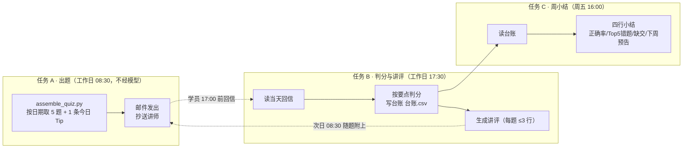
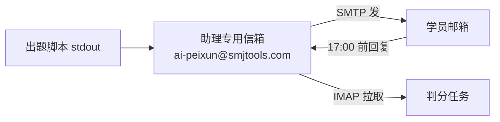

# 每日考试机制：定时任务怎么建、怎么跑、怎么闭环

> 配套：[10-SMJ-AI应用培训教学大纲](./10-SMJ-AI应用培训教学大纲.md) 第 5 章。
> 脚本与题库：`docs\培训\题库\`。这一套在模块 6 当堂建成并跑通——课件就是它自己。

---

## 1. 一张图看清三个任务



**分工原则**：出题走脚本（要每天稳、可复现、不花 token），判分与讲评走模型（要读人写的句子、组织语言）。

---

## 2. 本地先跑通（讲师机，PowerShell 或 bash 都行）

```powershell
cd D:\smj-apps\openworker\docs\培训\题库

python assemble_quiz.py --check                    # 题库体检：各模块题量与一周内复用密度
python assemble_quiz.py --check-tips               # Tip 库体检：条数、每周池子、字段完整性
python assemble_quiz.py --tips-md                  # 由 tips/tips.json 重新生成《每日Tip清单》讲义
python assemble_quiz.py --date 2026-11-04 --tip-only      # 只看当天轮到的那条 Tip
python assemble_quiz.py --date 2026-11-02 --simulate 40   # 模拟一学期 40 个出题日，查重题
python assemble_quiz.py --date 2026-11-02                # 学员版（不含答案），可复制粘贴发信
python assemble_quiz.py --date 2026-11-02 --key          # 讲师版（含答案与要点）
python assemble_quiz.py --date 2026-11-02 --commit       # 正式发信后登记，避免短期内重题
```

实测结果（本机 2026-10-26 跑的，不是设想）：

```text
当周模块一周需出 20 题（10 单选 / 5 判断 / 5 简答）
M0–M7 每模块 12–14 题，一周内每题平均出现 1.7–2.5 次（间隔重复，可接受）
模拟 40 个出题日：槽位 200，用到 100 道题，单日无重复，最常被出的题出现 5 次
Tip 轮换（10 个工作日）：10 个工作日 10 条各不相同；同一天重跑得到同一条
```

机制要点（脚本已实现，改之前先读）：

| 规则 | 实现 |
| --- | --- |
| 同一天重跑必须得到同一套题 | 已 `--commit` 的日期直接回放 |
| 周末不发题 | `--date` 落在周六/日 → 打印「跳过」，退出 0 |
| 当天 5 题不重复 | 选题时排除当日已选 |
| 优先出新题 | `used.json` 记已用；用尽才复用 |
| 复习上一周 | 第 5 题取上一周模块（第 1 周则当周补一题） |
| 今日 Tip 可复现 | 选取只依赖日期：第几个出题日 + 当周模块的池；每 3 个出题日插一条横切类（防错与安全 / 排障） |
| Tip 不计分 | 邮件里是「5 分钟动作」；做不到写「卡在第几步」，周五小结统计卡住率 |

`used.json` 是运行状态，**不要提交**（跟 `roster.csv` 一样留在管理员本机）。

---

## 3. 邮件通道：专用信箱，别用个人邮箱



- 建一个**专用**邮箱给程序用（永远不要把某个同事的收件箱交给程序）；开 IMAP；2FA 账号必须用 **app password**。
- 收发用 Himalaya 技能（`himalaya` CLI 走 IMAP/SMTP），凭据放 `~/.config/himalaya/config.toml`，密码文件 `chmod 600`，先自测 `himalaya envelope list`。详见官方指南 [Give Your Agent Its Own Email Address](https://hermes-agent.nousresearch.com/docs/guides/agent-email-address)。
- 想让人「发邮件问 Hermes」是另一件事（Email 通道），与上面这条**分开两个账号**。
- 备用通道：企业微信 / 微信（OpenWorker 的自动化直接「发送到微信」，见[微信接入手册](../手册/05-微信接入.md)）。考试按用户要求走邮件，微信只做提醒。

---

## 4. 三个定时任务（Hermes 侧）

```text
任务 A（纯脚本，不经模型）  30 8 * * 1-5
  python D:\smj-apps\openworker\docs\培训\题库\assemble_quiz.py --date 今天 --commit
  → stdout 交给邮件通道发出，抄送讲师邮箱。
  纯脚本模式：定时跑脚本，stdout 原样送达，零 token、结果可复现。
  参考 https://hermes-agent.nousresearch.com/docs/guides/cron-script-only

任务 B（走模型）  30 17 * * 1-5
  提示词见 templates/grading-prompt.md；挂 himalaya 技能读回信，按题库要点判分，
  追加台账 docs\培训\题库\成绩台账.csv，产出「答案与讲评」文本，供次日任务 A 附上。

任务 C（走模型）  0 16 * * 5
  读成绩台账 → 四行周小结 → 邮件发给全员，抄送部门负责人民。
```

排期用自然语言也行（`30 8 * * 1-5` 或「每个工作日早上 8 点半」），建、暂停、改、立即触发、删除都在同一个 cron 工具里，可以直接对 Hermes 说人话让它建。任务要跑在指定模型上就用 `--pin`/`cron.model`，别让换聊天模型把考试任务的模型一起换掉。参考资料：[Scheduled Tasks (Cron)](https://hermes-agent.nousresearch.com/docs/user-guide/features/cron)、[Cron Troubleshooting](https://hermes-agent.nousresearch.com/docs/guides/cron-troubleshooting)。

**OpenWorker 侧等价做法**（学员课上当场演示一遍）：新建自动化 → 指工作文件夹 → 设定时 → 「发送到微信/邮箱」→ 先点「立即运行」当集成测试。注意：无人值守时它把要发邮件的动作**攒进收件箱等审批**，不会自己发出去——这条必须在课上讲，否则学员会以为任务没跑。

---

## 5. 判分与反馈规则（写死，避免每届不一样）

| 题型 | 判法 | 分值 |
| --- | --- | --- |
| 单选 | 与题库 `answer` 一致即满分，不看理由 | 20 |
| 判断 | 选项对且理由不矛盾 | 20 |
| 简答 | 按 `key_points` 数要点：3 点中 2 → 14 分；4 点中 3 → 15 分 | 20 |

- 截止：当日 **17:00**；17:00 后为补交，每周补交不超过 2 次。
- 缺交：当天无回信即记 0，台账 `note` 写「缺交」。
- 讲评：每题不超过 3 行，只写「为什么错」，次日随题附上。
- 错题闭环：同一学员同一模块连续两次错 → 讲师 10 分钟单独辅导，周小结点名。
- 结业线（对齐大纲模块 8）：连续 5 个出题日平均 ≥80 分，缺交 ≤1。

台账（`成绩台账.csv`，不进 git）：

```csv
date,learner,email,mod,q1,q2,q3,q4,q5,score,submitted_at,note
2026-11-02,张三,alice@example.com,M0,B,A,A,要点2/3,B,80,10:12,简答漏「出处」
```

---

## 6. 邮件模板

- 学员版出题：由脚本生成，见 §2 第 3 行命令的输出。
- 讲师版（答案与要点）：`--key` 输出，只发给讲师。
- 讲评附言与周小结模板：[templates/email-templates.md](./templates/email-templates.md)。

---

## 7. 上线前检查（照着勾）

- [ ] 开班日改脚本里的 `START`（第一周周一），`WEEK_MODULES` 与实际排课一致。
- [ ] `roster.csv` 填真实名单（沿用[管理员手册](../手册/01-管理员初始化手册.md) §3.4 的 `email,name,dept,role`，**不进 git、不进共享盘**）。
- [ ] `--check` 通过（每题一周内 ≤2.5 次），`--simulate 40` 无单日内重题。
- [ ] `--check-tips` 通过（≥30 条、每周池 ≥4 条、每条五段字段齐全）；跑 `--tips-md` 生成讲义后**不要手改生成的 md**（改 tips.json 再重跑）。
- [ ] 抽查两天的邮件正文：Tip 块在题目前面，且同一天重跑得到同一条。
- [ ] 专用信箱自测：自己给自己发一封，收到且能回信；确认企业邮箱不会把回信吞进隔离区。
- [ ] 判分任务在**没有回信**时不报错（当天全员缺交也要正常写台账）。
- [ ] 时区确认 Asia/Shanghai；服务器/本机休眠会错过 tick —— 笔记本插电源或在工位机上跑。
- [ ] 每月看一次台账：正确率是否上台阶、错题是否集中在某模块（决定要不要重讲）。
