# 06 · 用上电脑里已有的技能，并升级到新版本

> 读者：所有使用者，不需要懂技术。
> 用时：第一次跟着做大约 10 分钟。

## 这份指引讲什么

有些同事的电脑上，已经用别的 AI 工具（比如 Claude Code、Kiro，或者一个叫 `npx skills` 的安装工具）装过一些「技能」。这份指引教你：

1. 让 smjworker 也能用上这些技能，**不用重新安装**；
2. 看清每个技能现在是什么情况：能不能用、是不是最新、有没有被改过；
3. 把需要的技能**升级**到新版本；升级后不满意，还能一键**退回**原来的版本。

电脑上没装过别的 AI 工具也没关系，照样可以读第 9 节，了解从「专家库」装的技能怎么升级。

## 先弄懂几个词

| 词 | 用大白话说 |
| --- | --- |
| 技能 | 一份写好的「做事说明书」。比如「把 PDF 翻成中文」「用打比方的方式讲清楚一件事」。智能体照着说明书做事，效果更稳定。 |
| 外部技能 | 别的 AI 工具装在你电脑上的技能。smjworker 直接拿来用，**不会复制，也不会改动它们**（升级除外，见第 7 节）。 |
| 来源 | 外部技能所在的文件夹。每个 AI 工具有自己的文件夹，比如「Claude Code」「Kiro」「通用目录（npx skills）」。 |
| 仅手动 | 平时不用它，**你点名时才用**。点名的方法：在输入框里打 `/` 选中它。好处是平时不占用模型额度。 |
| 自动 | 智能体觉得合适时会**自己**用它，不用你点名。 |
| 升级 | 把技能换成作者发布的新版本。 |
| 回滚 | 升级后不满意，退回升级前的版本。 |

## 开始前

- smjworker 已经装好，能正常聊天。
- 本指引的截图来自一台演示电脑。截图里的文件夹路径和你的不一样，你的电脑上会显示成 `C:\Users\你的用户名\.agents\skills` 这样的样子，这是正常的。
- 技能的介绍文字大多是作者写的英文，这不影响使用。

---

## 第 1 步：打开「技能」页

1. 点窗口**左下角**你的名字（没登录时显示「未登录」），弹出一个菜单。
2. 在菜单里点 **「设置」**。

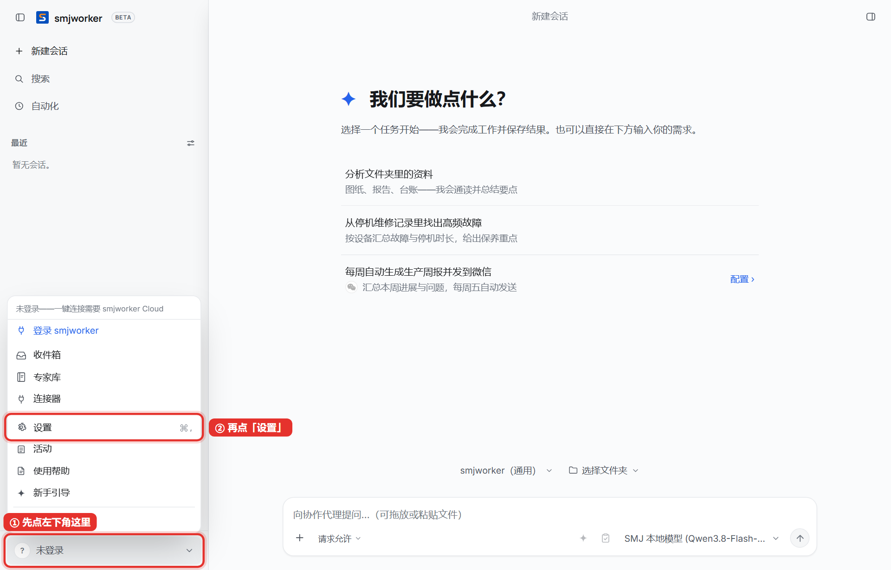

3. 在设置页左边的列表里，点 **「技能」**。

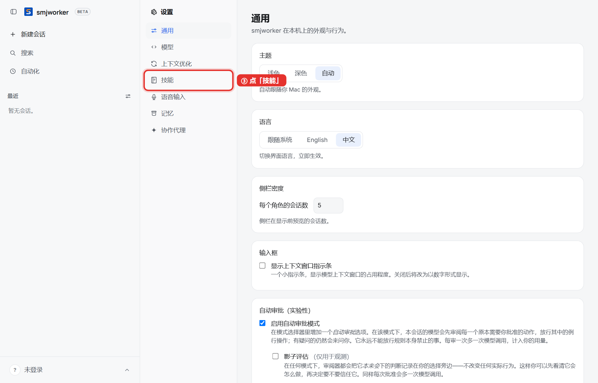

## 第 2 步：打开一个「来源」

技能页最上面有一块 **「外部技能来源」**，列出了 smjworker 在你电脑上找到的技能文件夹。

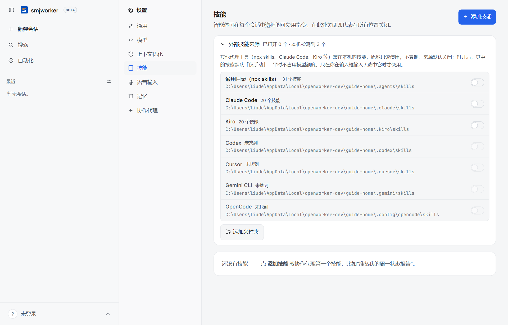

每一行是一个来源：

- 名字后面的「**31 个技能**」表示这个文件夹里有多少个技能；
- 显示「**未找到**」说明你电脑上没有这个工具的技能文件夹，它的开关是灰的，不用管；
- 右边的**开关一开始都是关着的**。smjworker 不会擅自使用别的工具的技能，要你自己决定打开哪个。

**建议先打开「通用目录（npx skills）」**：多数技能都装在这里，Claude Code、Kiro 等工具里的技能也常常就是它的副本。

4. 点「通用目录（npx skills）」右边的开关，让它变成蓝色。

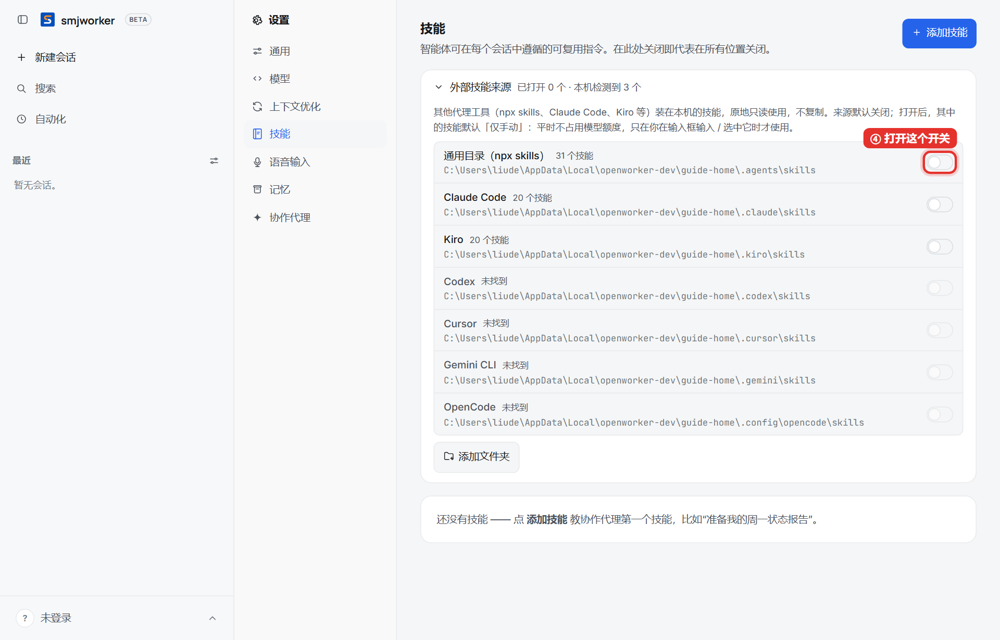

打开后，这个文件夹里的技能马上出现在下方的列表里。

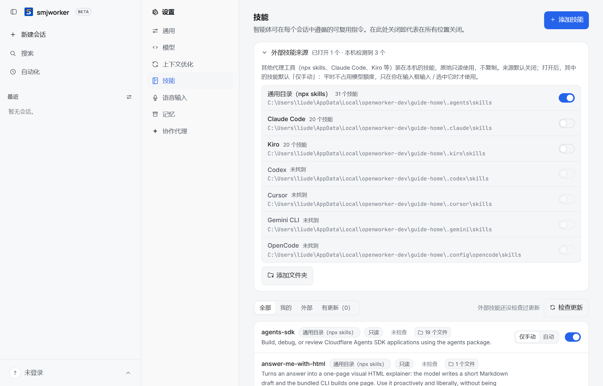

5. 想让页面清爽一点，可以点「外部技能来源」这几个字，把这一块**收起来**；再点一次又会展开。

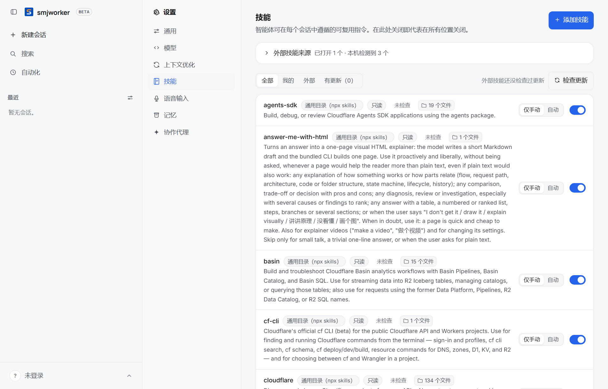

> 想关掉某个来源，把它的开关再点一次即可。关掉后，那个文件夹里的技能就不再出现，也不会被用到。

## 第 3 步：看懂每一行

列表里每一行是一个技能。以下面这一行为例：

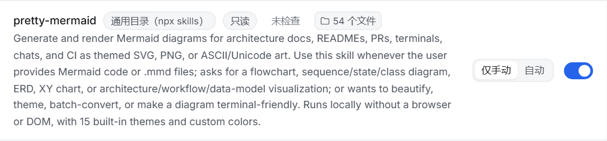

从左到右依次是：

| 你看到的 | 意思 |
| --- | --- |
| `pretty-mermaid` | 技能的名字。在对话里点名时用的就是它。 |
| 通用目录（npx skills） | 这个技能来自哪个来源。 |
| 只读 | 这是别的工具的技能，在这里**不能修改、不能删除**，所以这一行没有「编辑」「删除」按钮。要改请回到原来的工具。 |
| 本地已修改 / 有更新 / 已是最新 … | 这个技能的「版本情况」，见第 6 节的表格。刚打开来源时可能显示「未检查」。 |
| 54 个文件 | 技能里附带的文件数量。点它可以打开这个技能所在的文件夹看看。 |
| 一段英文 | 技能作者写的介绍，说明这个技能是干什么的。 |
| 本地改动：新增 test.svg | 只有「改过」的技能才有这一行，告诉你哪里和原版不一样。 |
| 仅手动 / 自动 | 这个技能怎么用，见第 4 步。 |
| 最右边的蓝色开关 | 这个技能用不用。关掉后，任何对话里都不会再用它。 |

有的技能只有一个灰色的「**仅手动**」标签，没有「自动」可选：

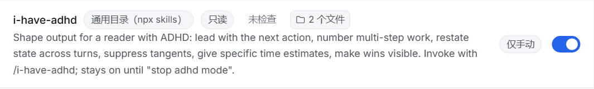

这是技能作者特意设定的「只能由你点名才用」，不能改成自动。

## 第 4 步：选择「仅手动」还是「自动」

外部技能默认是 **「仅手动」**。为什么这样设计？

> 智能体每次回答你之前，都要先看一遍「自动」技能的清单。清单越长，每次对话消耗的模型额度就越多。别的工具装的技能往往有几十个，其中很多你在这里根本用不上。所以默认先不放进清单，你点名时才用，平时不占用额度。

如果某个技能你经常用，希望智能体自己判断什么时候该用，就把它改成「自动」：

1. 找到这个技能，点它右边的 **「自动」**。

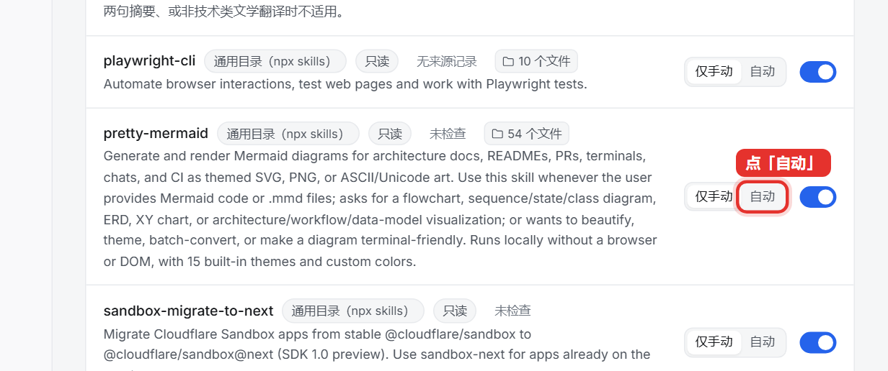

2. 页面顶部会出现一条绿色提示，说明从下一条消息起生效。

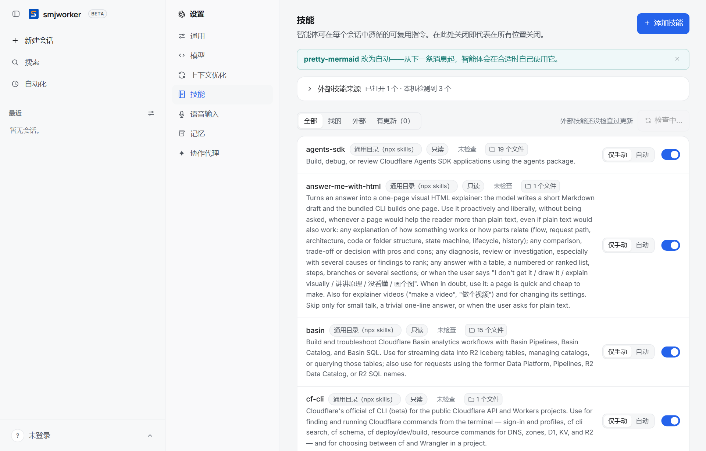

想改回来，点「仅手动」即可。

**小建议**：只把真正常用的几个技能改成「自动」，其余保持「仅手动」。

如果某个技能你暂时完全不想用，点它最右边的开关把它关掉：

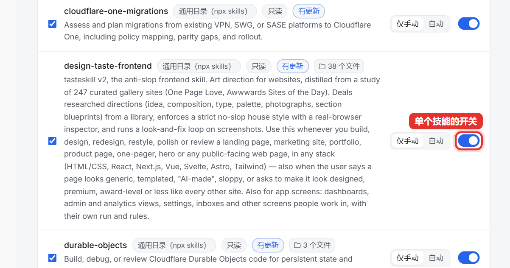

## 第 5 步：在对话里使用技能

「仅手动」的技能要你点名才会用。方法很简单：

1. 回到聊天页面（点左上角「新建会话」）。
2. 在下方输入框里打一个斜杠 `/`，再接着打技能名字的前几个字母，比如 `/el`。
3. 输入框上方会弹出匹配的技能。外部技能会标出「**仅手动**」和它来自哪个来源。**点它**，或者直接按回车键。

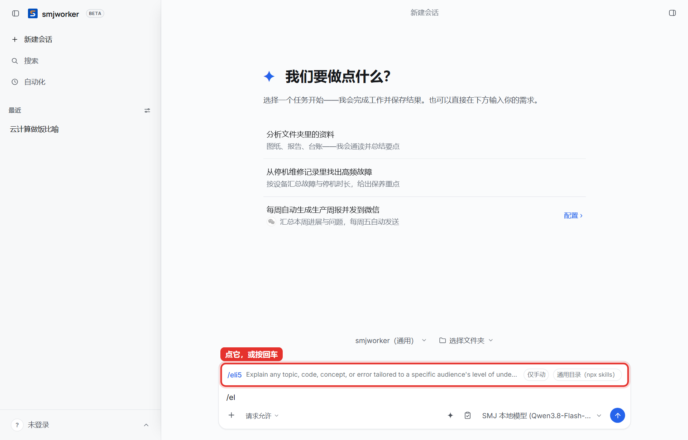

4. 输入框里会出现 `/eli5 `，接着写下你要它做的事，然后点右下角的**发送**按钮（或按回车）。

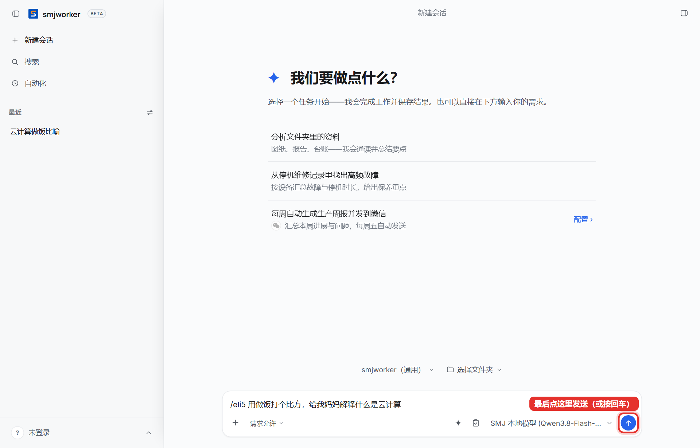

5. 回答里会有一行「**使用了技能：eli5**」，说明这次确实按这个技能来做了。

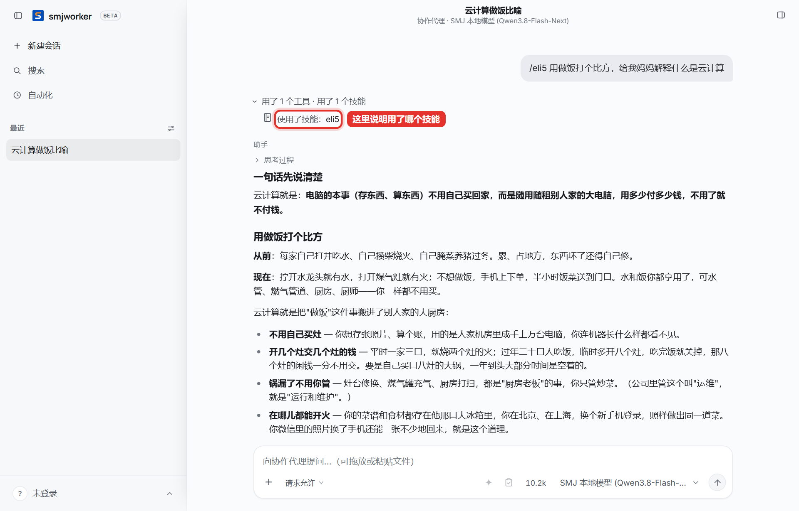

> 这个例子用的 `eli5` 技能，作用是「按对方的水平把事情讲明白」。你可以换成任何你需要的技能。

## 第 6 步：检查有没有新版本

技能的作者会不断改进技能。smjworker 可以帮你看看哪些技能出了新版本。

- **自动检查**：打开技能页时，如果从来没检查过，或者距离上次检查已经超过一天，会在后台自动检查一次，不用你操作。
- **手动检查**：随时可以点列表右上方的 **「检查更新」**。

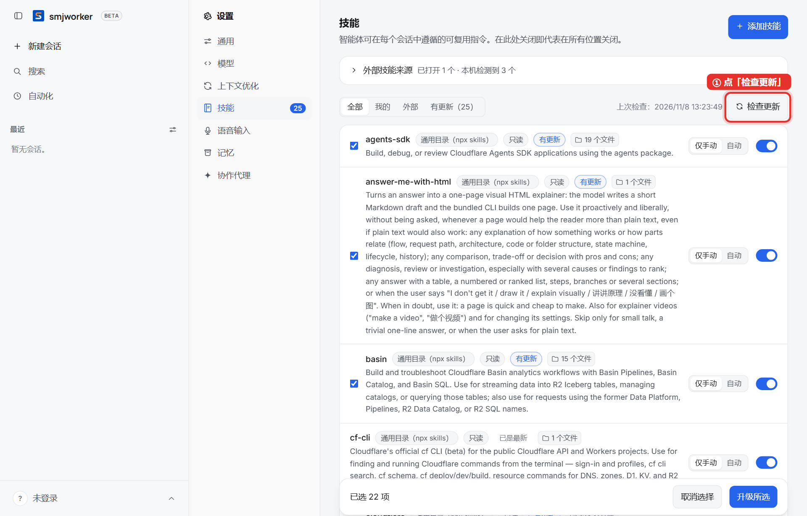

检查要连到网上的技能仓库，一般几秒钟完成。完成后，「检查更新」左边会显示上次检查的时间，每个技能都会标出版本情况：

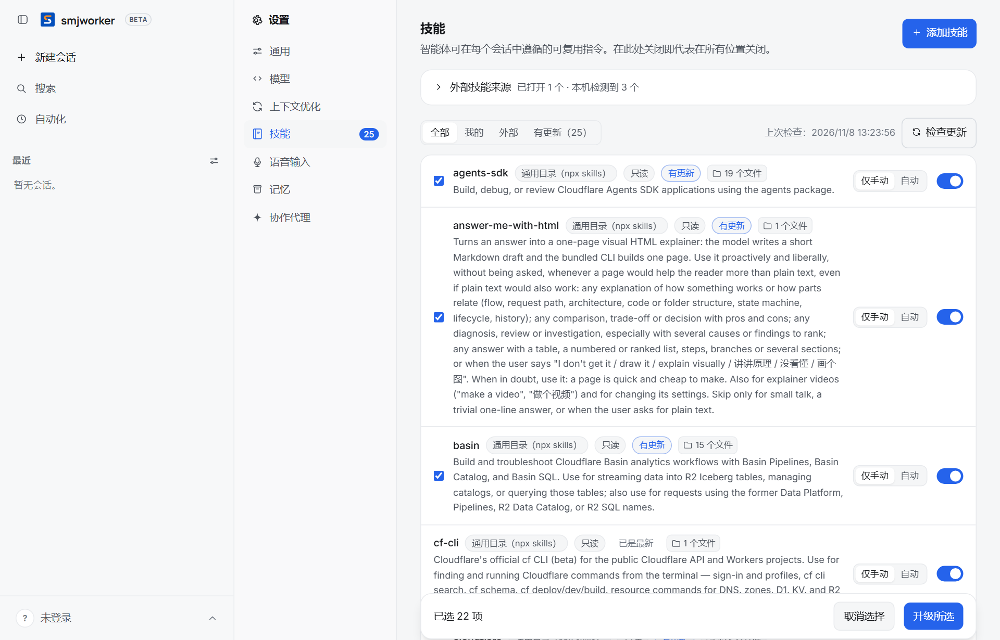

各种标签的意思：

| 标签 | 意思 | 要不要处理 |
| --- | --- | --- |
| 有更新（蓝色） | 作者出了新版本，你这份没改过。 | 可以放心升级。 |
| 有更新 · 本地已修改（橙色） | 有新版本，但你这份被改过（可能是你自己，也可能是别的工具）。 | 升级会覆盖这些改动，先看清楚再决定。 |
| 本地已修改（橙色） | 没有新版本，但你这份被改过。 | 不用处理。 |
| 已是最新 | 和作者最新版一样。 | 不用处理。 |
| 未检查 | 还没检查过。 | 点「检查更新」。 |
| 无来源记录 / 不可升级 | 不知道这个技能是从哪里装的（比如你自己写的、上传的），没法自动升级。 | 不用处理。 |
| 无法检查 | 检查时出了问题，把鼠标放在标签上能看到原因。 | 见第 11 节常见问题。 |

另外，设置页左边「技能」旁边的**蓝色数字**，表示现在有多少个技能可以升级：

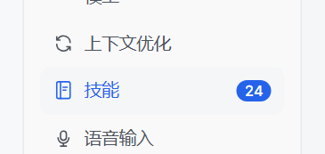

## 第 7 步：挑选并升级

1. 点列表上方的 **「有更新」**，只看能升级的技能。括号里的数字是能升级的个数。

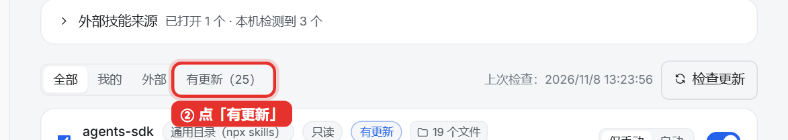

2. 每个能升级的技能左边都有一个**勾选框**，页面底部会出现一条「**已选 N 项**」的横条。

   - 普通的「有更新」默认**已经勾上**；
   - 「本地已修改」的默认**不勾**，并在下面写着改了哪些地方。这是为了防止你不小心把改动覆盖掉。

   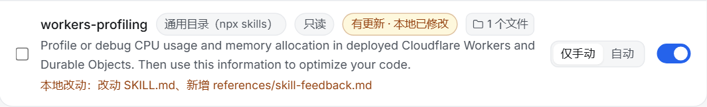

3. 不想一次全升级？点底部的 **「取消选择」** 把勾全部去掉，再只勾你想升级的那几个。
4. 勾好以后，点底部的 **「升级所选」**。

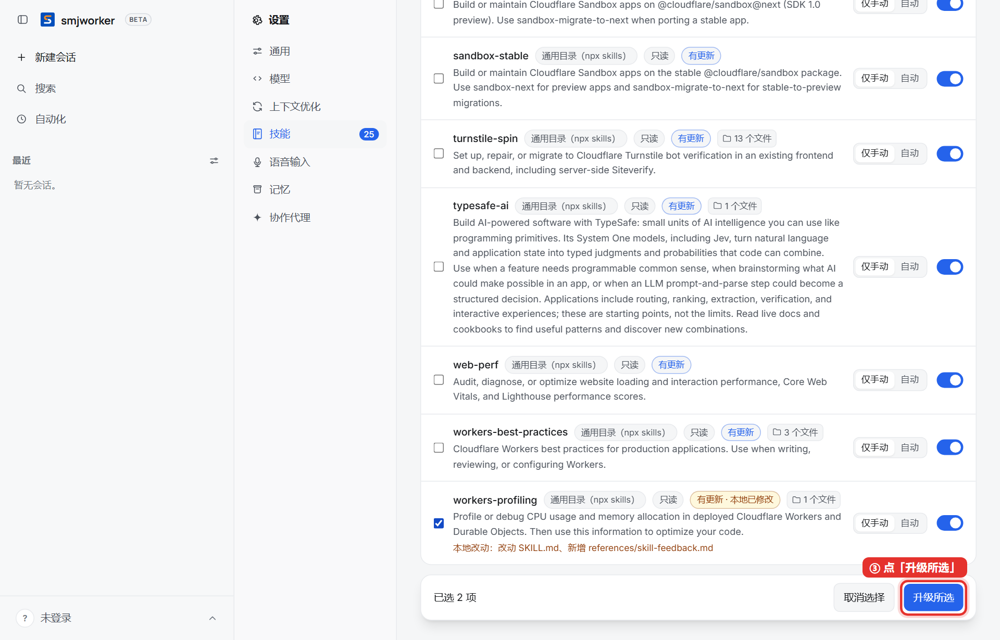

5. 如果你勾的技能里有「本地已修改」的，会先弹出一个确认框，列出这些技能和它们被改动的地方。

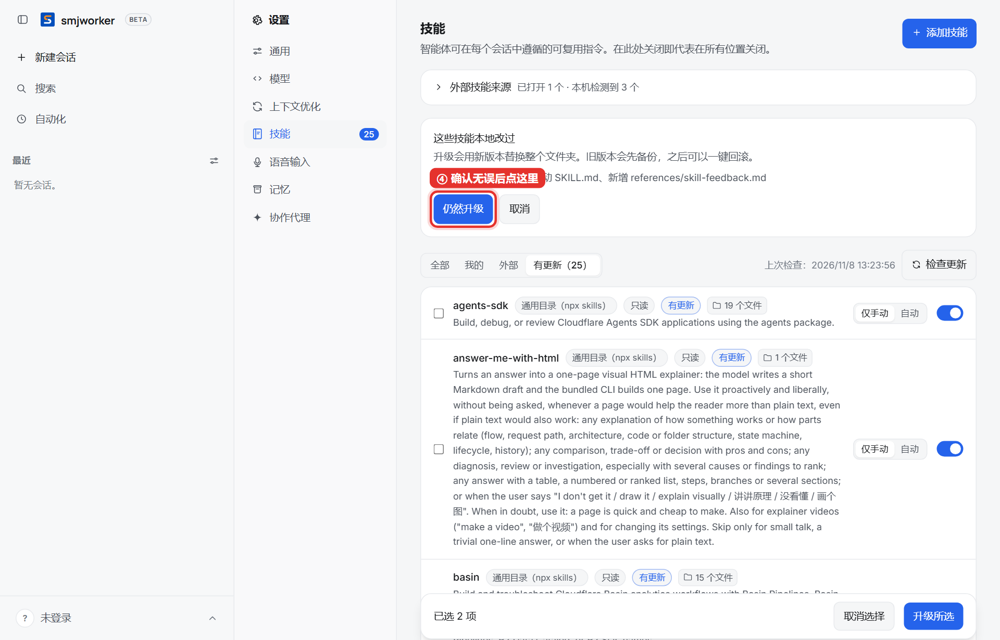

   - 确认可以覆盖，点 **「仍然升级」**；
   - 拿不准就点「取消」，什么都不会发生。

   不用太担心：**升级前，旧版本会先自动备份**，之后随时可以退回（见第 8 步）。

6. 升级完成后，页面上方会显示**升级结果**，逐个告诉你是否成功。

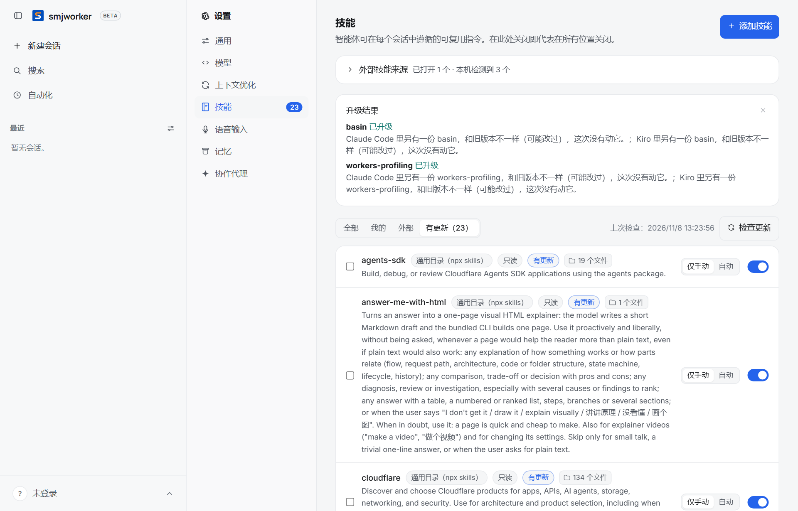

   结果里可能还有类似「Claude Code 里另有一份 basin，和旧版本不一样，这次没有动它」的说明。意思是：别的工具里也有一份同名技能，但内容和你这份不同，为了安全没有一起升级。一般不用处理。

> 升级会真正更新你电脑上那个技能文件夹，所以用原来的 AI 工具时，看到的也是新版本。

## 第 8 步：后悔了？一键回滚

升级过的技能，那一行会多出一个 **「回滚」** 按钮。

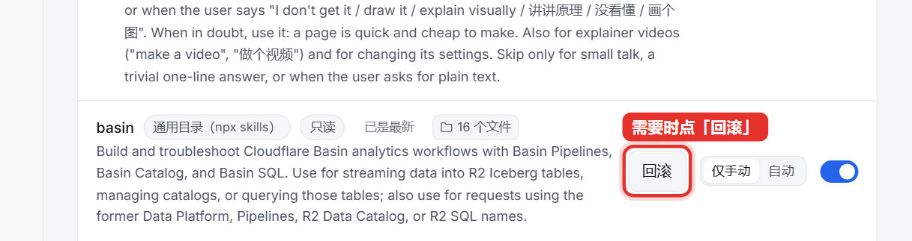

点它，技能就会恢复到升级前的样子，顶部提示「已回滚到上一个版本」，这个技能重新显示为「有更新」。

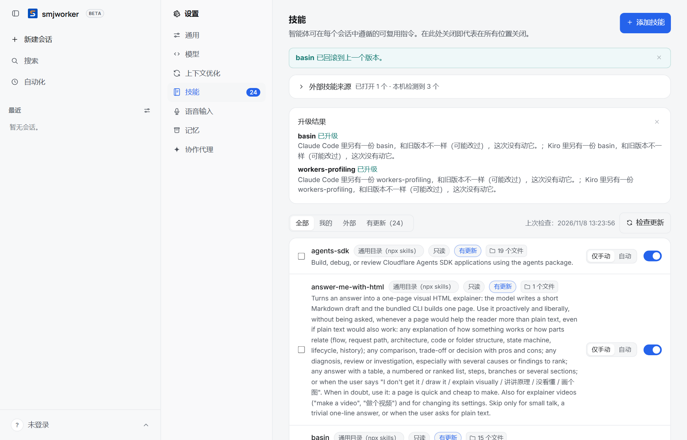

每个技能会保留最近 **3 次**升级前的备份。

## 第 9 步：从「专家库」装的技能

从「专家库」装的技能，在列表里标着「**内置库**」。它们的新版本跟着 smjworker 一起发布：smjworker 升级到新版本后，如果库里的某个技能也更新了，它会显示「有更新」，升级方法和第 7 步完全一样，同样可以回滚。

这类技能**不需要联网检查**，打开技能页就能看到最新情况。

你在设置里改过的库技能，会显示「本地已修改」，升级前同样会先请你确认。专家库里的「恢复原版」现在也会先做备份，恢复后觉得不对，可以在技能页点「回滚」找回你改过的版本。

## 第 10 步（可选）：添加自己的技能文件夹

如果你的技能放在别的文件夹里（比如同事共享给你的一个文件夹），可以把它加成一个来源：

1. 展开「外部技能来源」，点最下面的 **「添加文件夹」**。

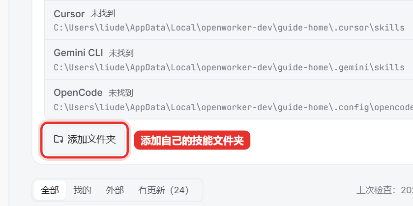

2. 在弹出的窗口里选中那个文件夹，点「选择文件夹」。
3. 新来源会出现在列表里，并且**自动打开**。不需要时可以关掉，或者点它右边的垃圾桶图标移除（只是不再使用，文件夹本身不会被删除）。

注意：选择的应该是**装着一个个技能的那个文件夹**，不能选整个磁盘或整个用户文件夹。

---

## 第 11 节：常见问题

**问：来源列表里全是「未找到」。**
答：说明你的电脑上没装过这些 AI 工具的技能。这不影响 smjworker 的其他功能，你仍然可以从「专家库」装技能，或者自己添加技能。

**问：打开来源后，列表一下子多了很多英文技能，会不会让智能体变慢、变贵？**
答：不会。外部技能默认「仅手动」，你不点名就不会用，也不占用额度。觉得列表太长，可以点列表上方的「我的」「外部」切换查看，或者把不需要的技能用最右边的开关关掉。

**问：在 smjworker 里能编辑这些外部技能吗？**
答：不能，它们是只读的。要修改，请回到原来安装它的工具里改。

**问：标签显示「无法检查」，把鼠标放上去看到「接口额度用完了」。**
答：检查更新要连到网上的技能仓库（GitHub），它限制每台电脑每小时的检查次数。提示里会写几点恢复，到时候再点「检查更新」就行。经常遇到的话，请联系管理员帮你设置访问凭证，次数会多很多。

**问：标签显示「无法检查」，把鼠标放上去看到「连不上 GitHub」。**
答：通常是网络问题。确认能正常上网后再试；公司网络限制访问时，请联系管理员。

**问：升级失败，提示「文件夹或里面的文件正被占用」。**
答：这个技能的某个文件正在别的程序里打开着（比如在编辑器里开着，或者另一个 AI 工具正在用它）。关掉这些程序后再点一次「升级所选」。这种情况下技能**不会被改坏**，原样保留。

**问：升级失败，提示「新版本里有密码、密钥之类的文件」。**
答：为了安全，smjworker 不会下载带有密钥文件的技能。这个技能可以继续使用旧版本；需要新版本的话，请联系技能作者或管理员。

**问：哪些技能显示「无来源记录」？能升级吗？**
答：smjworker 只能升级记得「从哪里装来的」技能。你自己写的、上传的，或者不是用 `npx skills` 装的外部技能，没有这个记录，所以不能在这里自动升级。

**问：升级后，原来的 AI 工具（比如 Claude Code）里的这个技能会变吗？**
答：会，用的是同一个文件夹，所以两边都是新版本。别的工具里如果另有一份**内容不同**的同名技能，smjworker 不会动它，升级结果里会写明。

**问：回滚之后还能再升级吗？**
答：能。回滚后它重新显示「有更新」，想升级时再勾选、点「升级所选」就行。
